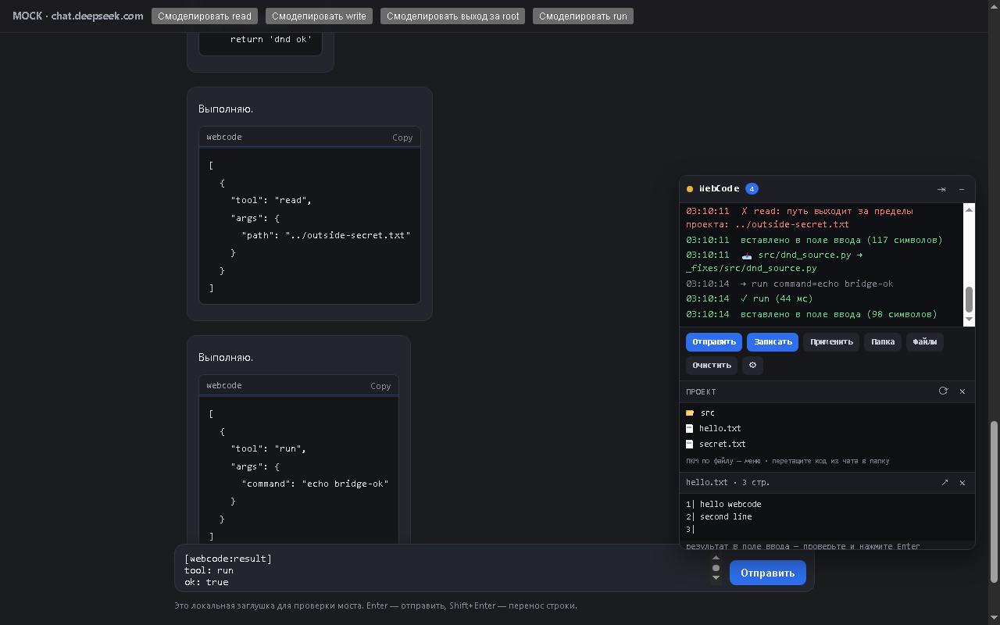
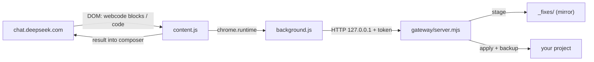

# deepseek-bridge

**Chat with DeepSeek. Apply to your repo — safely.**

[](https://github.com/maksyutoff90-bot/deepseek-bridge/releases)
[](LICENSE)

A Chrome extension plus a tiny local gateway that turns the DeepSeek web chat into
a coding agent for your machine: read and search files, propose edits, review them,
and only then write to the project — with backups. No API key, no cloud, no silent
file changes.

> Русская версия: [README.ru.md](README.ru.md)



## Why

* **No API key.** It drives the regular `chat.deepseek.com` UI, the way you already use it.
* **Review first.** Every edit lands in a `_fixes/` mirror of your project. Files in
  the project change only after you press **Apply** and confirm.
* **Nothing is lost.** Before overwriting, the original goes to
  `_fixes/.meta/backup/<timestamp>/`; deleting a file moves it to `_fixes/.meta/trash/`.
* **Local only.** The gateway binds `127.0.0.1`, requires a token, and refuses paths
  outside the project root.

## Features

| Area | What you get |
|---|---|
| Tool calls | The model answers with a ` ```webcode ` block: `list`, `tree`, `read`, `write`, `replace`, `grep`, `run` |
| Plain code | A normal code block with a filename above it is captured automatically — no special commands |
| Manual write | **Write** takes code from the last answer, shows the file paths (editable), and writes on confirm |
| File tree | Project tree in the panel: lazy folders, **drag & drop** code into a folder, drop files from Explorer, drag a file into the chat input to insert its path |
| Context menu | Right-click a file: open in VS Code, diff with the pending edit, preview, copy path, delete to trash |
| Send to chat | Right-click a file → its contents go into the composer with the path, so the model can analyse the code |
| Local checks | **Check** → scan the project (files, sizes, extensions, TODOs) or run the tests (`run_tests.bat` / `pytest`) without the model |
| Diff | `code --diff _fixes/... original` opens in VS Code |
| Panel | Floating or docked to the right, resizable by dragging the left edge |
| Projects | **Project** button (or the footer): recent folders, native Windows folder dialog, any path |
| File editor | Preview → ✎ → edit → 💾 saves straight into the project, old copy kept in `_fixes/.meta/backup` |
| File tabs | Opened files appear as chips above the preview: click to switch, ✕ to close |
| Workspace Write | **On by default**: model writes and captured code blocks go straight into the selected workspace, backups in `_fixes/.meta/backup`; toggle off to return to staging |
| Plugins | `plugins.json` in the project root: `[{"name": "…", "tool": "…", "args": {…}}]` → Check → Plugins… |
| Languages | English by default, Russian in the settings; switches live, no reload |
| Safety | Sandbox staging, apply confirmation, backups, “looks like a fragment” guard, token auth |
| Robustness | Ignores chat history (including history rendered late in a background tab) and SPA chat switches |

## How it works



1. The extension watches assistant messages for ` ```webcode ` tool calls and for
   plain code blocks with a nearby filename.
2. Tool calls go through the service worker to the local gateway (so the page CSP
   never matters). Writes are staged into `_fixes/`.
3. Results come back as plain text inserted into the chat input; the model continues.
4. You review and **Apply** — with a confirmation list of files and line deltas.

## Requirements

* Windows 10/11 (shell and paths are Windows-first; macOS/Linux mostly work)
* Node.js 22+
* Chrome or Edge 137+ (the extension is loaded unpacked)
* VS Code CLI `code` — optional, for “open” and “diff”

## Install

```powershell
git clone <your-repo-url> deepseek-bridge
cd deepseek-bridge
.\start-gateway.cmd
```

**No store account needed.** Run `install.cmd`: it copies the extension to
`%LOCALAPPDATA%\deepseek-bridge\extension` and puts that path on your clipboard.

1. Open `chrome://extensions`, enable **Developer mode**, click **Load unpacked**,
   paste the path (`Ctrl+V`) — or choose the `extension` folder from the repo (or
   download the release zip and unzip it first).
2. Open the extension options (⚙ in the panel) and paste the token and port `8787`.
3. Open `https://chat.deepseek.com` and send the contents of
   [`SYSTEM_PROMPT.md`](SYSTEM_PROMPT.md) as the first message.
4. Ask for a change. Edits appear in `_fixes\`; press **Write** or **Apply** and confirm.

There is no public store listing yet: Chrome Web Store requires a one-time \$5
developer account, and Edge Add-ons is free and accepts the same zip. Until then the
unpacked install above is the way.

## Usage

* **Ask for a fix.** The model answers with a tool call or a plain code block.
* **Review.** The panel shows `📥 path → _fixes/path`; the project is untouched.
* **Apply.** **Apply** lists the files and line deltas; confirm to write (backup kept).
* **Manual path.** If the model wrote a block without a filename, press **Write**,
   type the path (or pick one), and confirm.
* **Drag & drop.** Drag a code block onto a folder in the tree, or drop files from
   Explorer into it. Drop a file from the tree into the chat input to insert its path.
* **Inspect.** Right-click a file in the tree: open in VS Code, diff, preview.

## Configuration — `gateway/config.json`

| Key | Meaning |
|---|---|
| `root` | The only folder the gateway can see (also `--root`) |
| `port` | HTTP port, default `8787` |
| `token` | Empty → read from `gateway\.token`, or generated |
| `sandbox` | `true` (default) — edits go to `_fixes`; `false` — write directly |
| `sandboxDir` | Name of the staging folder, default `_fixes` |
| `allowWrite` | `false` for read-only mode |
| `allowRun` | `false` to disable shell commands |
| `runTimeoutMs` | Command timeout, default 30 s |
| `mock` | Serve the local mock chat at `/webcode-mock/` |

## Privacy

* **What leaves your machine:** only what you send to the chat. Tool results (file
  reads, command output) are inserted into the composer and go to
  `chat.deepseek.com` when you press Enter.
* **What stays local:** the token, the gateway, `_fixes/`, backups, logs. There is
  no telemetry, no analytics, no third-party server.
* **What the extension reads:** the current chat page and your project files, only
  when a tool call or drop requires it. It does not read other tabs or browsing
  history.
* **Local data:** `_fixes/.meta/manifest.json` (edit history), `_fixes/.meta/backup`
  and `_fixes/.meta/trash`; `gateway/logs/gateway.jsonl` (tool calls).

Full policy: [PRIVACY.md](PRIVACY.md).

## Security model

* The token lives in extension storage; the page cannot read it. The gateway listens
  on `127.0.0.1` only.
* Paths are resolved against `root` and rejected if they escape it (including
  symlinks and absolute paths).
* `run` is a **real shell** with your user rights — it bypasses the sandbox. Set
  `allowRun: false` if you do not need it.
* Prompt injection is real: the model reads files, and text inside a file can
  contain instructions. Keep the project in git, review `_fixes` before applying.
* Secrets (`.env`, keys) are **not** excluded from reads yet — keep them out of the
  root or disable `run`.

## Limitations

* The extension is unpacked; Chrome may drop its site access after files change —
  reinstall it (`Remove` → `Load unpacked`).
* DeepSeek markup is parsed heuristically; a UI redesign may require tweaks in
  `extension/content.js`.
* Staged writes are full-file replacements (no patch hunks yet).
* One gateway serves one project root.
* Files up to 2 MB can be dropped from Explorer.

## Development

```powershell
node tools\e2e.mjs
```

40 end-to-end checks: gateway tools, sandbox staging, apply with backup, fragment
guard, secret-free path checks, `background.js`, and the browser flow (read, write,
plain-code capture, drag & drop, context menu, dock/resize, auto-send). The test
installs the extension into a clean Chrome profile via CDP, so the real service
worker is exercised.

```
gateway/        HTTP gateway: /health, /exec, /webcode-mock
  server.mjs    routing, auth, logging
  tools.mjs     tools, sandbox, manifest, backups
extension/      Manifest V3: background, content script, panel, options
mock/           local chat page for tests
tools/e2e.mjs   40 checks + screenshot
```

## Roadmap

* diff preview inside the panel (accept/reject hunks)
* deny-list for secrets and key files
* “Undo last apply” button
* autopilot with a step limit and a stop button
* gateway auto-start and a packaged `.crx`

## License

MIT — see [LICENSE](LICENSE).


## Autostart (Windows)

Run once:

```powershell
powershell -ExecutionPolicy Bypass -File install-autostart.ps1
```

It puts a shortcut to `start-gateway-hidden.vbs` into the Startup folder, so the
gateway starts hidden at sign-in. Disable with:

```powershell
powershell -ExecutionPolicy Bypass -File uninstall-autostart.ps1
```

The token is read from `gateway\.token` by the panel and by the VS Code extension,
so nothing else is needed after login.
